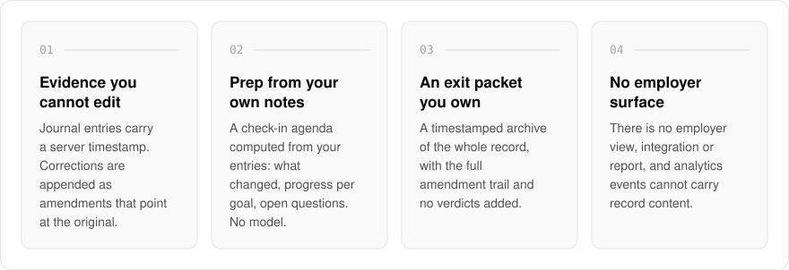
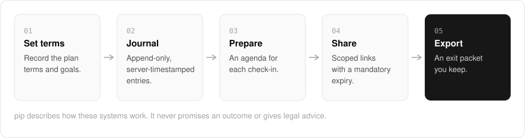

<h1 align="center">pip.me.at</h1>

<strong>How performance review actually works inside big tech.</strong>

  
  
  

  <a href="#features">Features</a> ·
  <a href="#how-it-works">How it works</a> ·
  <a href="#built-with">Built with</a>

When you are put on a performance improvement plan, the record of what happened usually lives on your employer's systems, in their words. I am building pip.me.at to explain how ratings, calibration and improvement plans really work, and to give someone in one a private workbook: plan terms, an append-only evidence journal, check-in prep, and an exit packet that is yours alone, never your employer's. It describes how these systems work and never promises an outcome or gives legal advice.

> **Status:** the product logic is built and tested, but the site is not public yet.

  <picture>
    <source media="(prefers-color-scheme: dark)" srcset=".github/assets/overview-dark.svg">
    
  </picture>

## Why pip.me.at

| The usual record of a plan | pip.me.at |
| --- | --- |
| Notes in a document anyone can quietly edit | An append-only journal with server timestamps and visible amendments |
| Kept on the employer's systems | No employer view, integration or report, by design |
| Meeting prep from memory | An agenda computed from your own entries, with no model involved |
| Shared in full, forever | Share links that expire, with each part of the record opt-in |

## Features

- **Append-only evidence journal**: entries carry a server timestamp and cannot be edited or deleted. Corrections and retractions are appended as amendments that point at the original.
- **Check-in prep**: a per-meeting agenda computed from your own entries (what changed since the last check-in actually held, progress per goal, open questions), with no model involved.
- **Exit packet you own**: a timestamped archive of the whole record, rendered as text or HTML, with the full amendment trail shown and no verdicts or claims added.
- **Share links that fail closed**: every share has a mandatory expiry, and scope defaults to plan terms and goal status, with journal entries, check-ins and artifacts each opt-in.
- **Fenced AI assist**: deterministic pre-call fences (distress escalation first, then legal-advice referral, then a no-fabrication rule) stop a request before any model is called, and answers carry provenance.
- **Content-free analytics and no employer surface**: analytics events cannot carry record content, and there is structurally no employer-side view, integration, or report.
- **Course and blog structure**: a course catalog with outline, reading path, progress and related lessons, and a matching blog structure, ready for written content.

## How it works

  <picture>
    <source media="(prefers-color-scheme: dark)" srcset=".github/assets/flow-dark.svg">
    
  </picture>

You start by recording the plan's terms and goals, then keep an evidence journal whose entries are timestamped by the server and can only be amended, never rewritten. Before each check-in, an agenda is computed from those entries. You can share a scoped, expiring view of the record, and at any point export the whole thing as an exit packet you keep.

## Built with

  
  
  
  
  

- Next.js 16 (App Router), React 19, TypeScript
- Tailwind CSS 4
- Drizzle ORM + Postgres
- Better Auth
- oRPC
- A provider-agnostic AI layer (Anthropic or a configurable driver) behind pre-call guards
- The shared me.at content pipeline for course and blog posts

## Part of the me.at family

pip.me.at is one of my [`*.me.at`](https://me.at) apps. They share one design system, account, and app shell. Development happens in a private monorepo; this repository is the project's public-facing home.

## License

Source-available. See [LICENSE](LICENSE).
